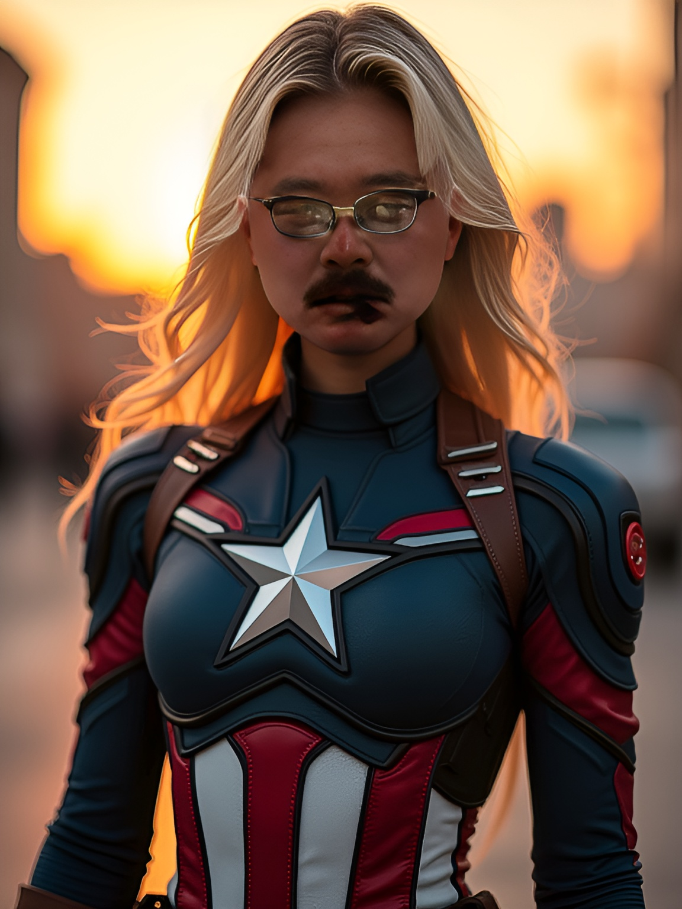
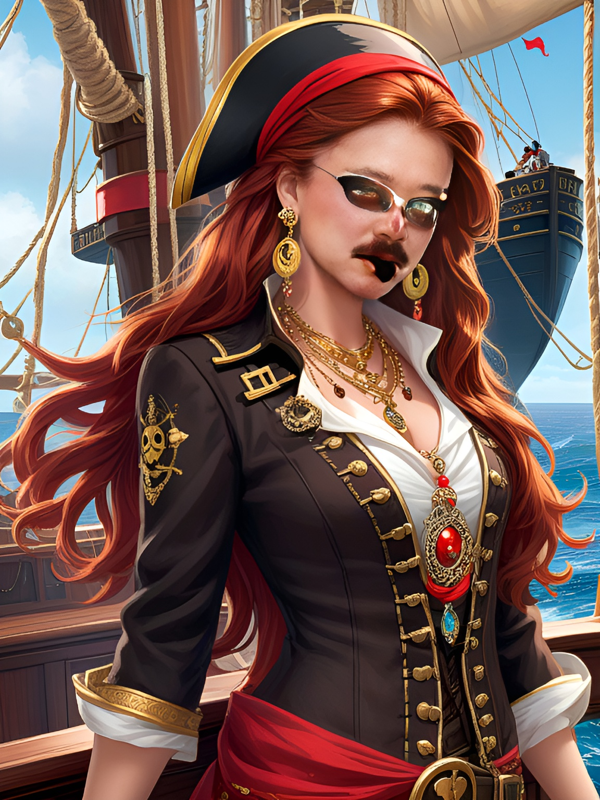

# Genius Art 2API (gen-ai.amobear.com)

逆向 Genius Art Image AI Generator v1.5.4 (ElaMods Mod)，OpenAI 兼容 demo + new-api 渠道文档。

## 两个模型（均已实测出图）

| 模型 | 上游端点 | 能力 | 输出 | 耗时 |
|---|---|---|---|---|
| `genius-art` | `/v5/tools/prompt-to-image` | 文生图（同步） | 512×512 | 8~34s |
| `genius-art-styled` | `/v5/tools/predict-art` | **照片→风格模板**（异步三步） | **1152×1536** | 5~10s |

`genius-art-styled` 带 **1553 个风格模板**（52 组：生肖/纹身/海盗/狼人/漫画/圣诞/Captain…），`GET /styles` 可取全清单。

## 真图证据

| 文生图 Ghibli | 文生图 Ukiyo-e | 风格 Captain | 风格 Pirate |
|---|---|---|---|
|  |  |  |  |

## 快速开始

见 [NEWAPI_INTEGRATION.md](NEWAPI_INTEGRATION.md)

```bash
python demo_server.py emulator-5570 8907
curl http://127.0.0.1:8907/v1/models
```

## 压测结论

| 场景 | 结果 |
|---|---|
| 文生图 4 并发 | 4/4，wall 18.3s |
| 文生图 8 并发 | 8/8（复测）wall 33-38s，p50 22s |
| 风格模型 4 并发 | 4/4，wall 10.4s（5.6~10.4s/张）|
| 上游同 device 10 并发 | 全 201，无配额上限 |
| 号池 | get-token 每次随机 device_id，JWT 14 天，天然无限 |
